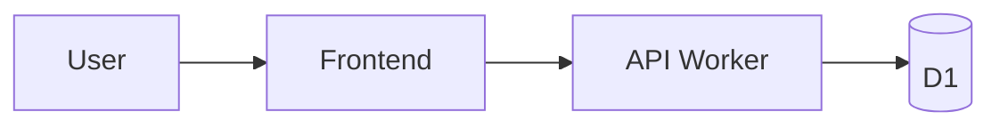

# <Project> — Implementation Spec
_Status: draft · Owner: <name> · Updated: <date> · Playbook: <greenfield | brownfield | migration>_

## 1. Problem, users, jobs-to-be-done
## 2. User stories
- As a <user>, I want <action> so that <outcome>.
## 3. Non-goals
## 4. Success metrics
North Star: … · Guardrails: …

## 5. Architecture
### 5.1 Components

### 5.2 API contract
| Method | Path | Auth | Request | Response | Errors |
|---|---|---|---|---|---|
### 5.3 Data model & migrations
### 5.4 Auth & permissions matrix
| Role | Resource | Read | Write | Admin |
|---|---|---|---|---|
### 5.5 Environments, deploy, observability
### 5.6 Compatibility (brownfield/migration) — see `.starkstack/compat.md`

## 6. Assumptions (from decisions.md)

## 7. Ticket board
### Wave 1
- [ ] T-01 · Agent 2 architect + 6 devops · Tracer bullet: UI → API → DB → preview deploy
      blocked_by: — · blocks: all · outputs: — · acceptance: hello-world flow live on preview · size: M
- [ ] T-02 · Agent 1 designer · Flows, tokens, DESIGN.md
### Wave 2
- [ ] T-03 · Agent 3 db-engineer · Schema + migrations
- [ ] T-04 · Agent 7 test-engineer · Contract tests from §5.2
### Wave 3
- [ ] T-05 · Agent 4 backend-dev · <route>
- [ ] T-06 · Agent 5 frontend-dev · <page>
### Wave 4
- [ ] T-07 · Agent 10 reviewer · Review + blast radius
- [ ] T-08 · Agent 8 qa-tester · QA pass
- [ ] T-09 · Agent 9 security-tester · Threat model, scans, fixes
- [ ] T-10 · Agent 11 release-engineer · PRs, CI, merge, release, canary
- [ ] T-11 · Agent 12 tech-writer · README, API docs, runbook, retro

## 8. Review scorecard
| Reviewer | Score | Top gap | Change made |
|---|---|---|---|

## 9. In plain words
<3 sentences for a non-engineer>
